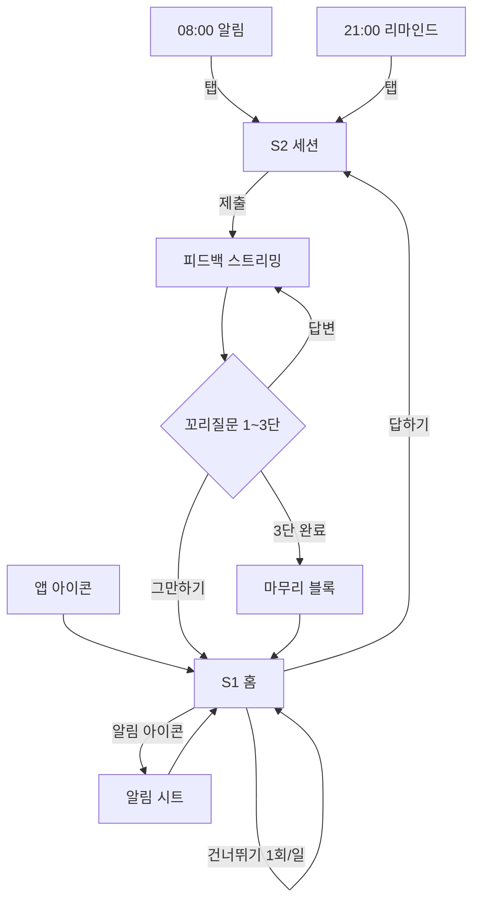

# 디자인 문서
상태: 확정 / 수정일: 2026-11-08

> 순서: 브랜드 → 디자인 시스템 → 화면 목록 → 화면 설계 → 백엔드에 필요한 데이터.
> 모바일 우선(세로, 한 손). 배포 형태(웹/토스 미니앱)는 미정이므로 갈리는 지점만 §6에 모았다.

---

## 1. 브랜드

- **이름**: 꼬리 (kkori)
- **마스코트**: 여우 '꼬리'. 코치가 아니라 **옆에 앉아 있는 동료**다. 칭찬도 비난도 하지 않는다.
- **한 줄**: 매일 답할수록 꼬리가 길어진다.
- **톤**: 가볍게, 짧게, 평가하지 않게. 느낌표를 쓰지 않는다. "잘했어요" 대신 "오늘도 답했어요".

### 1-1. 꼬리 길이 = 연속 기록

연속 기록을 숫자 배지로 보여주지 않는다. **꼬리 자체가 숫자다.** 일러스트 6장을 그리는 대신 **길이를 계산식으로 정의**해서 프론트가 숫자로 그린다(상태가 늘어도 자산이 안 늘어난다).

```
꼬리 길이(px) = 56 + 8 × min(streak, 30)      → 56px(0일) ~ 296px(30일+)
곡률            = 단계별 토큰 (아래 표)
```

| 단계 | streak | 꼬리 모양 | 홈 문구 |
|---|---|---|---|
| 0 씨앗 | 0 | 뭉툭하고 짧다. 몸에 붙어 있다 | 오늘 첫 답을 기다려요 |
| 1 시작 | 1–2 | 한 번 휘어진다 | 1일째 |
| 2 자람 | 3–6 | 두 번 휘어진다 | 3일째 |
| 3 풍성 | 7–13 | 털 밀도 +1단, **끝이 흰색** | 7일. 꼬리 끝이 하얘졌어요 |
| 4 무성 | 14–29 | S자 두 겹 | 14일째 |
| 5 긴꼬리 | 30+ | 화면 가로를 감싸 돌아온다 | 30일. 꼬리가 한 바퀴 돌았어요 |

- **마일스톤(7·30일)은 모양이 바뀌는 날에만 홈에서 1회 짚는다.** 모달·폭죽 없음. 꼬리가 달라진 걸 보는 것이 보상이다.
- **유령 꼬리**: 최장 기록을 현재 꼬리 뒤에 흐린 외곽선(ink-200, 점선)으로 겹친다. 리셋돼도 과거가 지워지지 않는다는 걸 숫자 없이 보여준다.
- **리셋은 애니메이션하지 않는다.** 짧아지는 모션은 상실을 연출해 압박이 된다. 조용히 짧은 꼬리 + "다시 1일부터"만.
- **건너뛰기한 날**은 꼬리가 자라지도 짧아지지도 않는다. 꼬리 끝에 점선 1칸(요구사항 4-1: 연속 유지).

---

## 2. 디자인 시스템

### 2-1. 색
평가의 색(빨강/초록)을 피드백에 쓰지 않는다. "점수화 안 한다"(기획 §2)가 색에서도 지켜져야 한다. 의미색은 **시스템 상태 전용**이다.

| 토큰 | 값 | 용도 |
|---|---|---|
| `fox-500` | `#F2762E` | 주색. 꼬리, 주 버튼, 포커스 링 |
| `fox-600` | `#D95F1A` | 눌림 |
| `fox-100` | `#FFEFE4` | 주색 배경, 꼬리질문 블록 |
| `ink-900` | `#17171A` | 본문·질문 |
| `ink-500` | `#6B6B72` | 보조 텍스트, 캡션 |
| `ink-200` | `#E4E4E9` | 구분선, 유령 꼬리, 스켈레톤 |
| `paper` | `#FFFFFF` | 배경 |
| `paper-alt` | `#F7F7F9` | 카드, 입력창, 피드백 블록 |
| `alert-500` | `#D9434E` | 시스템 에러만. 피드백 본문에 금지 |
| `ok-500` | `#2E9E6B` | "저장됐어요" 확인만 |

- **다크 모드는 MVP에서 하지 않는다.** 하루 5~10분 세션에 분기 두 배는 과하다. 기본값으로 라이트를 고른다.

### 2-2. 타이포그래피
Pretendard Variable(subset) + fallback `-apple-system, system-ui`. 웹폰트는 `font-display: swap`, 질문 본문만 선로딩.

| 역할 | 크기/행간 | 굵기 |
|---|---|---|
| Question | 22 / 34 | 600 — 질문 전용. 화면에서 가장 큰 글자 |
| Title | 20 / 28 | 600 |
| Body | 16 / 27 | 400 — 피드백·답변. 행간을 넓게 둔다(읽기용) |
| Label | 14 / 20 | 500 — 버튼, 카테고리 |
| Caption | 12 / 16 | 400 — 메타, 남은 횟수 |

### 2-3. 레이아웃·간격
- 간격 4배수. 쓰는 값만: `4 / 8 / 12 / 16 / 24 / 32 / 48`
- 콘텐츠 최대 폭 `420`, 좌우 패딩 `20`
- 터치 타깃 최소 `48×48`, 주 버튼 높이 `56`
- 반경: 카드·입력 `16`, 버튼 `14`, 시트 상단 `24`
- 그림자 1단만: `0 2px 8px rgba(23,23,26,.06)`. 입체감으로 위계를 만들지 않는다 — 크기와 여백으로 만든다.
- **주 버튼은 하단 고정(sticky)**, 세이프에어리어 + 12 여유.

### 2-4. 컴포넌트 (MVP에 실제로 쓰는 것만)

| 컴포넌트 | 내용 | 동작 | 필요 데이터 |
|---|---|---|---|
| `TailMascot` | 여우 + 계산된 꼬리 + 유령 꼬리 | 단계 변경 시 300ms ease-out로 자람만 | streak, longestStreak, isSkippedToday |
| `QuestionCard` | 카테고리 라벨 + 질문 본문 | 없음(읽기 전용) | category, questionText |
| `AnswerComposer` | 다줄 입력 + 글자 수 + 제출 | 10자 미만이면 제출 비활성 + 하단 안내문 | draft, minLength, 남은 재시도 |
| `FeedbackBlock` | 좋은 점 / 빠진 점 / 한 줄 정리 | 스트리밍 중 커서 표시 | 블록별 텍스트, 완료 여부 |
| `StreamCursor` | 1.5ch 폭 깜빡이는 막대 | 토큰 도착마다 이동 | — |
| `DepthDots` | ●●○ 꼬리질문 3단 | 표시 전용 | currentDepth |
| `PrimaryButton` | 1화면 1개 | 로딩 시 레이블 자리에 스피너, 폭 유지 | label, state |
| `InlineRetry` | 문장 + "다시" | 자동 카운트다운 후 재시도 | retryAfterSec |
| `NotifySheet` | 시각 + 알림 끄기 | 홈에서 올라오는 시트 | notifyEnabled, notifyTime |

### 2-5. 네 가지 상태 — 공통 규칙
꼬리는 AI와 네트워크에 기대는 서비스다. **빈·로딩·에러가 예외가 아니라 일상이다.** 그래서 상태별 틀을 먼저 고정하고, 성공은 그 틀의 한 경우로 둔다.

| 상태 | 틀 | 금지 |
|---|---|---|
| **빈** | 꼬리 마스코트 + 한 줄 + 행동 1개. 일러스트 추가 금지 | "데이터가 없습니다" 같은 시스템 말투 |
| **로딩** | 들어올 콘텐츠 모양의 스켈레톤(ink-200, 1.2s shimmer). 전체 화면 스피너는 **쓰지 않는다** — 레이아웃이 흔들리면 인지 부하가 올라간다 | 스피너 + 빈 배경 |
| **에러** | 같은 자리에서 인라인 복구. 문장 1줄 + "다시" 1개. 코드·스택 숨김 | 모달, 토스트만 띄우고 끝내기 |
| **성공** | 다음 행동으로 바로 이어진다. 축하 화면을 따로 만들지 않는다 | 전면 모달, 폭죽 |

- **로딩 300ms 미만은 스켈레톤을 띄우지 않는다**(깜빡임 방지).
- 에러 문구는 **원인이 아니라 사용자가 할 일**을 쓴다: "네트워크가 끊겼어요. 답은 저장돼 있어요. 다시 →"

---

## 3. 화면 목록 (확정)

초안의 5화면을 다음과 같이 **2화면 + 1시트**로 줄였다.

| 초안 | 판단 |
|---|---|
| 홈 | **유지.** 보상(꼬리)을 볼 유일한 자리 |
| 답변 작성 | **세션으로 통합** |
| AI 피드백 | **세션으로 통합.** 피드백은 답변의 결과다. 화면을 나누면 "읽고 뒤로 가기"라는 가짜 행동이 하나 생긴다 |
| 꼬리질문 | **세션으로 통합.** 할 행동이 "답을 쓴다"로 답변 작성과 완전히 같다. 같은 행동에 화면을 두 개 두지 않는다 |
| 기록 | **삭제.** 기획 백로그 Could(§5). Must가 아니고, 하루 1루프 구조에서 과거를 뒤지는 행동은 루프 밖이다 |

| # | 화면 | 이 화면에서 할 단 하나의 행동 |
|---|---|---|
| S1 | **홈** | 오늘의 질문에 들어간다 |
| S2 | **세션** | 지금 요구되는 답을 쓴다 (원 질문 1 + 꼬리질문 3) |
| — | 알림 시트 (S1 부속) | 알림 시각을 고르거나 끈다 |

- **온보딩은 넣지 않았다.** 기획 백로그 Should다. 알림 권한은 첫 세션 완료 직후 홈에서 한 줄로 요청한다(이유를 본 뒤에 묻는 순서는 유지).
- **설정 화면을 만들지 않았다.** 요구사항 4-4가 요구하는 항목이 시각/끄기 두 개뿐이라 시트로 충분하다. 다른 옵션은 기본값으로 정했다.

---

## 4. 화면 설계

### 4-0. 전체 흐름



---

### 4-1. S1 — 홈

**목적**: 오늘의 질문에 들어간다. (꼬리 확인은 보상이고, 행동은 하나다)
**진입**: 앱 아이콘, 세션 종료, 시트 닫기
**이탈**: 답하기 → S2 / 건너뛰기 → 같은 화면의 다음 질문 / 앱 종료

**레이아웃 (위 → 아래)**
```
1  상단바   : 좌 "꼬리"  우 알림 아이콘(꺼져 있으면 사선)
2  꼬리     : TailMascot + 유령 꼬리 (화면 높이의 35%)
3  기록 줄  : "7일째 · 최장 12일 · 누적 23답"   ← Caption 한 줄, 세 숫자 모두
4  질문 카드: QuestionCard (카테고리 + 질문)
5  주 버튼  : [답하기]  / 이미 답했으면 [피드백 다시 보기]
6  보조     : "오늘은 건너뛸게요"  ← 텍스트 링크, 1회 쓰면 사라짐
```

**상태**

| 상태 | 화면 |
|---|---|
| **빈 (질문 풀 소진)** | 꼬리 + "오늘 꺼낼 질문이 비었어요. 내일 아침에 다시 올게요." 주 버튼 없음. **에러로 보이게 하지 않는다**(요구사항 4-1) |
| **빈 (streak 0, 첫 방문)** | 씨앗 단계 꼬리 + "첫 답을 하면 꼬리가 자라요" + [답하기] |
| **로딩** | 꼬리는 즉시 그린다(로컬 캐시 streak). 질문 카드만 스켈레톤 2줄. 버튼은 비활성 상태로 자리 유지 |
| **에러** | 질문 카드 자리에 InlineRetry: "질문을 못 받아왔어요. 다시 →". 꼬리와 기록 줄은 캐시로 계속 보인다 — **전체 화면을 에러로 덮지 않는다** |
| **성공(답변 완료일)** | 꼬리가 1단계 자란 모습, 버튼은 [피드백 다시 보기], 건너뛰기 링크 없음 |
| **마일스톤(7/30일)** | 기록 줄 위에 한 줄만 추가: "꼬리 끝이 하얘졌어요". 당일 1회 |

**과부하일 때**: 질문 조회가 느리면 캐시된 어제 화면을 보여주지 않는다(날짜가 틀리면 신뢰가 깨진다). 스켈레톤 유지 → 5초 넘으면 "조금 붐벼요. 다시 →".

---

### 4-2. S2 — 세션

**목적**: 지금 요구되는 답을 쓴다.
**구조**: 세로로 쌓이는 **하나의 기록(transcript)**. 질문 → 내 답 → 피드백 → 꼬리질문 → 내 답 … 순으로 아래로 길어진다. 화면 전환이 없으니 "방금 뭐라고 썼지"를 위해 뒤로 갈 일이 없다(인지 부하 ↓).
**바닥에는 항상 하나만 있다**: 입력창 **또는** 다음 버튼. 둘이 동시에 있으면 입력창을 남기고 버튼을 뺀다.

**진입**: 홈 [답하기], 알림 탭(홈을 거치지 않고 직행)
**이탈**: 뒤로/닫기(초안·생성분 보존) / 그만하기 / 3단 완료

**레이아웃**
```
1  상단바  : 닫기(×)   중앙 DepthDots ●○○   우 Caption "재시도 1회 남음"
2  스크롤  : 질문 → [내 답] → [피드백 3블록] → [꼬리질문] → [내 답] ...
3  하단고정: AnswerComposer  또는  PrimaryButton
```

**AnswerComposer**
- placeholder: "면접관 앞이라고 생각하고 편하게"
- 10자 미만: 제출 비활성 + 입력창 아래 Caption "10자 이상 쓰면 보낼 수 있어요". **AI 호출 전에 막는다**(요구사항 4-2)
- 제출 즉시 내 답이 기록에 붙고 입력창은 닫힌다 — **낙관적 업데이트**. 서버 확인 전이라도 "쓴 것"은 사라지지 않는다
- 초안은 로컬에 자동 저장. 앱을 닫고 와도 입력창에 남아 있다

**피드백 스트리밍 — 글자가 나오는 동안**
```
제출 → 0~3초 : 블록 3개 틀만 그린다(라벨 + 스켈레톤 2줄). 자리를 먼저 잡아
                 글자가 들어올 때 레이아웃이 안 흔들린다
     → 첫 토큰: "좋은 점" 스켈레톤이 텍스트로 교체, StreamCursor 깜빡임
     → 블록 전환: 다음 블록 라벨에 커서 이동. 스크롤은 커서를 따라가되
                 사용자가 위로 스크롤하면 추적 중단(가로채지 않는다)
     → 완료     : 커서 소멸, 하단에 [꼬리질문 받기]
```
- 3초가 지나도 첫 토큰이 없으면 스켈레톤 아래 Caption: "면접관이 생각 중이에요". 버튼은 만들지 않는다(기다림을 선택지로 바꾸지 않는다)

**스트리밍이 중간에 끊겼을 때** — 이 서비스에서 가장 흔한 실패다
```
[좋은 점] 트랜잭션 경계를 ... 여기까지 생성됨
──────────────────────────
 끊겼어요. 쓴 답과 여기까지 받은 피드백은 저장됐어요.
 3초 후 이어서 받기 · [지금 이어받기]
```
- **받은 부분은 절대 지우지 않는다.** 처음부터 다시 그리면 사용자는 자기가 읽은 것을 잃는다
- 자동 재시도 1회(3초 뒤) → 또 실패하면 수동 버튼만 남긴다
- 재시도는 **이어받기**다. 같은 답변에 대한 재생성이 아니므로 재시도 2회 카운트를 쓰지 않는다
- 이어받기도 실패: "피드백은 못 받았지만 **오늘 답변은 기록됐어요**. 꼬리는 자랐어요." + [홈으로]. 요구사항 4-2의 "AI가 실패해도 손해 없다"를 화면에서 증명한다

**이탈 후 복귀**: 세션 화면을 다시 열면 생성된 지점까지 즉시 렌더 → 미완이면 커서 복귀 후 이어 받는다. 로딩 화면을 거치지 않는다.

**꼬리질문**
- fox-100 배경 블록 + DepthDots 갱신. 맥락(원 질문/내 답)은 이미 위에 있으니 다시 쓰지 않는다
- 하단에 "모르겠어요" 텍스트 링크 1개 → 핵심 2~3줄만 흐르고 **더 내려가지 않는다**. 톤은 그대로, 위로 문구 금지
- "그만하기"는 상단 × 과 겹치므로 따로 두지 않는다. × → "여기까지 할까요? 오늘 기록은 이미 됐어요" 확인 1단
- 3단 완료: 마무리 블록 "여기까지 따라왔어요" + 자란 꼬리 썸네일 + [홈으로]. **완료 화면을 따로 만들지 않는다**

**상태 요약**

| 상태 | 화면 |
|---|---|
| 빈 | 질문 + 빈 입력창 + 비활성 제출. 커서가 입력창에 자동 포커스(알림 직행 시) |
| 로딩 | 블록 틀 + 스켈레톤. 전체 스피너 없음 |
| 에러 | 위 "끊겼을 때" 블록. 인라인, 모달 금지 |
| 성공 | 피드백 3블록 완성 + 다음 행동 버튼 1개 |
| 과부하(429) | "면접관이 밀려 있어요. **12초 뒤 자동으로 다시 시도해요**" + 카운트다운. 서버가 준 대기 시간을 그대로 쓴다 |
| 재시도 소진 | 입력창 비활성 + Caption "오늘 재시도를 다 썼어요. 내일 새 질문이 와요" |

**이때 서버에 필요한 동작** (대표 담당)
- 과부하·실패 응답에 **재시도 대기 초(Retry-After)** 를 담아줄 것. 프론트가 숫자를 임의로 정하면 몰려서 재시도한다
- 재시도 요청에 **멱등키**를 받을 것. "중복 과금 없음"(4-2)은 화면만으로 못 지킨다
- 세션 재진입 시 **생성된 텍스트 오프셋**을 돌려줄 것. 이어받기와 "처음부터 다시"의 차이가 여기서 갈린다
- AI 실패와 무관하게 **답변 저장·스트릭 증가는 먼저 확정**될 것

---

### 4-3. 알림 시트 (S1 부속)

**목적**: 알림 시각을 고르거나 끈다.

```
핸들
"아침 몇 시에 질문 보낼까요"
[ 07:00 ] [ 08:00 ✓ ] [ 09:00 ] [ 직접 고르기 ]
Caption  "바꾼 시각은 내일부터예요"
────────────
알림 받기            [토글 ON]
Caption  "끄면 오늘의 질문도 안 가요"
```
- 기본값 08:00. 프리셋 3개로 결정을 줄인다(선택지를 늘리는 건 결정을 떠넘기는 것이다)
- 21:00 리마인드는 **설정에 노출하지 않는다.** 미답변자에게만 가고 하루 2건 상한이 있으니 조절할 거리가 아니다
- 권한 거부 상태: 토글 자리에 "기기 설정에서 알림이 꺼져 있어요 → 설정 열기" 1줄
- 저장은 즉시(저장 버튼 없음), ok-500 한 줄 "바꿨어요" 1.5초

---

## 5. 화면이 필요한 데이터 (항목까지만)

> 엔드포인트·테이블은 대표(백엔드)가 정한다.

**S1 홈**
- 오늘 날짜(KST 기준, 서버 판단) / 질문 id · 카테고리 · 본문
- 오늘 상태: 미답변 | 답변완료 | 건너뜀 | 질문없음
- 연속 기록: 현재 streak, 최장 streak, 누적 답변 수, 꼬리 단계 변경 여부(마일스톤 당일 플래그)
- 건너뛰기 남은 횟수
- 알림 설정: on/off, 발송 시각

**S2 세션**
- 세션 id, 원 질문(카테고리·본문)
- 내 답변 목록(depth, 본문, 저장 확정 여부)
- 피드백: depth별 3블록(좋은 점/빠진 점/한 줄 정리), 블록별 완료 여부, **생성 오프셋**
- 꼬리질문: 현재 depth(1~3), 본문, 종료 여부
- 남은 재시도 횟수, 최소 글자 수
- 실패 정보: 실패 종류(끊김/과부하/소진), **재시도 대기 초**, 멱등키
- 답변 저장·스트릭 인정 여부 (AI 성공과 분리된 값)

**알림 시트**
- 현재 시각 설정, on/off, 기기 권한 상태

---

## 6. 배포 형태에 따라 갈리는 지점

| 지점 | 일반 웹(PWA) | 토스 미니앱 |
|---|---|---|
| 알림 권한 | iOS는 홈화면 추가 후에만 푸시 가능 → 홈에 "홈화면에 추가" 1줄이 **추가로 필요** | 네이티브 푸시, 추가 화면 없음 |
| 알림 탭 → 세션 직행 | 딥링크 복원 실패 시 홈으로 폴백 화면 필요 | 라우팅 보장, 폴백 불필요 |
| 상단바 | 자체 × / 뒤로 | 호스트 네비게이션과 중복 → 자체 상단바 좌측을 비운다 |
| 로그인 | 허용 목록 + 간단 로그인 화면 1개 필요 | 토스 ID, 로그인 화면 없음 |
| 세이프에어리어 | 자체 처리 | 호스트 규격 준수 |

**영향**: 웹이면 화면이 최대 2개 늘어난다(로그인, 딥링크 폴백). 미니앱이면 2화면 + 시트로 끝난다. 결정이 나면 이 표만 접는다.

---

## 7. 결정된 것

**홈(S1)을 남긴다.** (대표 확정 2026-11-08, 결정 로그 #10)

알림이 유일한 트리거라 세션으로 직행하면 사용자가 꼬리를 **한 번도 안 볼 수 있다.** 보상이 안 보이면 스트릭은 장치로 작동하지 않는다. 세션 종료 → 홈 착지로 매일 1회는 꼬리를 보게 만든다. 홈을 없애는 대안(1화면)은 더 얇지만, 세션을 중간에 그만둔 날 꼬리를 못 보고 재방문할 곳 자체가 사라진다.

**인계: frontend에게 S1 홈 / S2 세션 / 알림 시트.** 배포 형태가 정해지면 §6의 해당 열만 적용한다.

---

## 해설
- 화면을 5 → 2로 줄인 건 기능을 뺀 게 아니라 **같은 행동(답을 쓴다)에 중복된 화면을 접은 것**이다. 단일 transcript는 근접성·연속성(게슈탈트)으로 맥락을 유지해 화면 간 기억 부담(닐슨 #6 인식 > 회상)을 없앤다.
- 성공 화면보다 **끊김·과부하·AI 실패 화면을 먼저 확정**했다. 부분 출력 보존 + 인라인 이어받기 + "답변은 저장됐다"는 명시는 사용자 제어·복구(닐슨 #9)를 스트리밍 UI에 적용한 형태다.
- 스트릭은 숫자 배지가 아니라 **꼬리 길이 계산식 + 유령 꼬리**로 설계해, 보상은 보이되 상실 연출과 비교 압박은 빼고 가변 보상 대신 가시적 진행(progress)만 남겼다.
